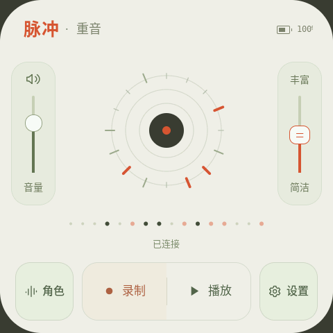
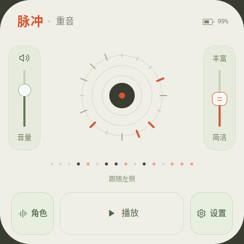

# Echoy for Mosaico

English · [简体中文](README_CN.md)

Tap a rhythm on Mosaico, connect tiles side by side, and let different musical voices respond to each other.

**[Download firmware](https://github.com/MacChu0315/Echoy/releases/tag/echoy-three-basic-ba951963754a) · [Installation guide](docs/installation.md) · [Developer guide](docs/development.md)**

  
  

Actual device screenshots: a connected pair, both paused. [Image source](docs/screenshots/README.md).

> **Before you start:** v1.0.0 needs startup calibration—keep tiles at least **15 cm apart on a nonmetal surface** when powering on or restarting. **Rearranging a running three-tile chain can fail to reconnect the moved tile.** [Known issues](docs/releases/v1.0.0.md#what-was-accepted-and-what-was-not).

## Play in three steps

1. **Record.** Tap Record, wait for **3, 2, 1**, then tap during four beats. Your phrase plays back once and stops. Recording captures touch timing, not microphone audio.
2. **Connect.** Place another tile on the right, facing the same direction. It follows the left phrase; connecting does not automatically start continuous playback.
3. **Make an ensemble.** Choose Pulse, Voice, Dust or Harmony, then tap Play on each tile you want to hear. Each tile has its own Pause. Detaching retains its phrase and playing/paused state for the current session.

Use up to three tiles in a same-orientation horizontal chain. Restarting clears recorded phrases and resets role choices. [More about installation and use](docs/installation.md).

## Which version should I use?

Download **v1.0.0** for the preserved three-device build. It is a **pre-release with known limitations**, not a fully accepted three-device version.

**`master` now uses the same application code as the three-device download, with newer documentation on top.** For the exact release source snapshot, use tag [`echoy-three-basic-ba951963754a`](https://github.com/MacChu0315/Echoy/tree/echoy-three-basic-ba951963754a).

[Versions, source tags and checksums](docs/releases/v1.0.0.md) · [Accepted dual-device source](https://github.com/MacChu0315/Echoy/tree/echoy-dual-accepted-20261014)

## For developers

Echoy uses shared C musical logic and native ESP-GSP UI. The [developer guide](docs/development.md) covers environment setup, the audible desktop simulator, builds and tests.

The separate [Mosaico Skills branch](https://github.com/MacChu0315/Echoy/tree/skills/mosaico-development) contains eight reusable engineering and experience/design guides, with their validation limits documented.

## License and maintenance

Original Echoy code and documentation: [MIT](LICENSE), © 2026 MacChu0315. Third-party components retain their own licenses; **ESP-GSP is restricted to Espressif products**. Keep the [third-party notices](THIRD_PARTY_NOTICES.md) and license materials with redistributions.

Echoy is preserved as a working experiment. No regular updates or ongoing support are currently planned.
