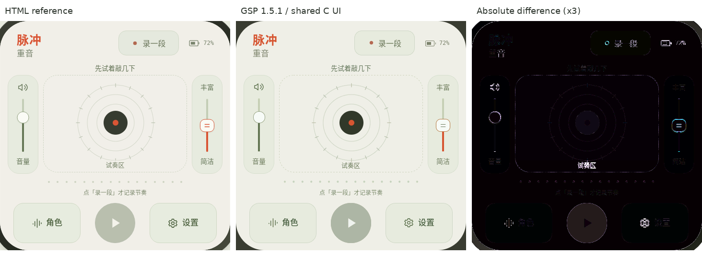

# Home UI foundation verification

These results cover the initial Chinese Pulse home screen and its recording
state model. They do not establish complete Echoy parity or hardware acceptance.

The left panel is the unchanged supplied HTML, the middle is GSP 1.5.1 running
the native C backend, and the right is the absolute RGB difference amplified
three times. No global similarity percentage is used as an acceptance rule.
Font rasterization, rounded edges and RGB565 quantization remain visibly
different. Internal text ink positions were measured against the browser;
button labels use the actual Noto CJK Medium face, not a guessed bold face.
The small dashed border is a rasterized SVG decoration because GSPC 0.6.1
rendered `stroke-dasharray` as a solid stroke. No page screenshot is used as UI.

## Actual checks

- `sha256sum -c SHA256SUMS` from `reference/`: both supplied files match.
- `cmake -S tests -B build-host`, `cmake --build build-host`,
  `ctest --test-dir build-host --output-on-failure`: 1 test executable,
  7 behavior groups pass (count-in, leading silence, audition-only taps,
  empty/cancel retention, quantization, stale preparation and clock/fault cases).
- `gcc -std=c11 -Wall -Wextra -Werror -g -fsanitize=address,undefined ...`:
  the same 7 groups pass, including LeakSanitizer outside the ptrace sandbox.
  The initial sandbox attempt failed because LeakSanitizer cannot run under ptrace.
- `python3 tools/check_home.py`: 9 native checks pass. They compile the current
  C backend before launching the official simulator and inject input only through
  its public API. Holding the pad for 400 ms crosses multiple quantization cells.
  Both `last_error=0` and `cleanup_error=0` are required. Details: [checks](native-checks.json).
- The pinned low-noise build runner reports `IDF LOW-NOISE BUILD: OK`,
  ESP32-S31, zero warnings, `echoy.bin` 1,295,440 bytes. Latest run:
  `projects/echoy/.codex-runs/idf-low-noise-build/20261007-190012-build-433583/`.
- Read-only review identified initialization ownership, feedback and test gaps;
  these were corrected and the five findings were rechecked.

The simulator uses the same `echoy_ui.c`, `echoy_model.c`, `echoy_art.c` and
GSP resources as the firmware. The PC adapter supplies monotonic time.
The current output service is explicitly simulated; no audio is synthesized.

## Captured states

[Count-in](countin.png), [recording](recording-leading-silence.png),
[one-shot preview](preview.png), [cancelled](cancelled.png),
[volume maximum](volume-max.png).

## Remaining work

- Role/settings/detail/fault pages and English UI; the visible role/settings
  buttons currently have no navigation handler.
- All twelve accompaniment plans, actual C audio and output scheduling.
  Current graphics show recorded anchors, not a completed accompaniment engine.
- Multi-device transport, identities and clocks; real battery and peripherals.
- Actual screen/touch, acoustic timing, resource use and device acceptance.
- A user decision for the device version of "Put away this tile (simulation)".
  No device write has been performed.
